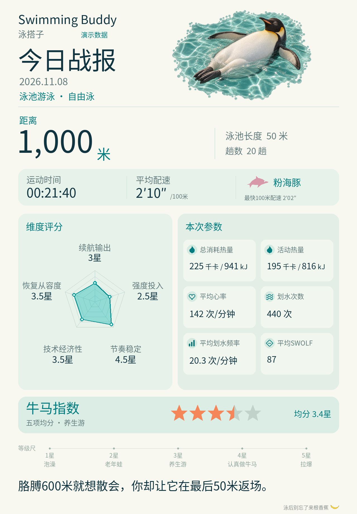

# Swimming Buddy｜泳搭子

上传游泳截图，说说今天游得怎么样，得到一张今日战报和一句贴合这次训练的锐评。



当前试用版：`1.2.15-rc.1+fresh-quips.20261108`。可以先用包内示例体验，也可以上传自己的运动截图。

## 能做什么

- 从手表或 App 截图中读取清晰可见的距离、用时、配速、心率、划水次数和分段，保留原始数据与出处。
- 生成手机版战报、高清战报和详细数据报告，展示五维娱乐评分、动物配图，以及有完整百米成绩时的海豚评级。
- 根据这次训练的数据和你的感受，写一句不超过 45 字的锐评。每次重新写，不套用固定句库。
- 经你确认身份并同意保存后，将运动记录存到技能文件夹之外的个人目录。只想体验时，可以选择不保存。

## 怎样使用

Swimming Buddy 是给 Codex 等支持 Skills 的 AI 助手使用的技能。AI 助手负责看图、询问感受和写点评，Python 脚本负责检查数据和生成图片。

### 安装

需要 Python 3.10 或以上，以及 Pillow 12.3.0。目前已在 macOS、Python 3.14.6、Pillow 12.3.0 的组合下验证，其他组合尚未验证。

下载并解压技能包，在技能目录中运行：

```bash
python -m pip install -r requirements.txt
python scripts/install.py
```

默认安装到 `$CODEX_HOME/skills/swimming-buddy`；未设置 `CODEX_HOME` 时，安装到 `~/.codex/skills/swimming-buddy`。

如果已有不同内容的同名技能，安装器会先停止。请核对现有文件，并按安装器要求提供文件清单和备份位置后再更新。Windows、Linux 或其他 AI 助手中的技能加载方式，需要在对应环境中确认。

### 开始一次泳训点评

在 Codex 中输入下面这段话，同时上传运动概览和分段截图：

```text
$swimming-buddy
帮我看看这次游泳，生成今日战报。
我今天前面比较轻松，后半程胳膊有点酸，最后50米冲了一下。
先体验，不保存。
```

没说体感时，助手会问一句“今天游完感觉怎么样？”你也可以直接说“跳过体感，先出卡”。

首次使用成人百米成绩参考时，助手会询问采用男生组还是女生组。职业和兴趣可以不填。

## 先看一个演示

示例是一场虚构的 1000 米自由泳，用时 21 分 40 秒。模拟感受是前 300 米轻松、600 米后胳膊酸、最后 50 米主动加速。对应点评：

> 胳膊600米就想散会，你却让它在最后50米返场。

包内附有[高清战报](docs/demo-full.png)和[完整示例数据](docs/demo-input.json)。示例使用虚构数据，运行时不保存到个人运动记录。

## 数据怎么看，记录存在哪

- 看不清的数值留空，保留能读到的原文；有疑问时再核对。
- 海豚评级使用完整 100 米成绩。全程平均配速不能代替最快百米成绩；不同泳姿、池长和设备计数方式的数据需要分开比较。
- 五维星级和“牛马指数”用于娱乐。了解身体状况或制定医疗方案，应咨询专业人员。
- 图片在本地绘制。AI 助手读取截图时，仍按该助手的数据处理规则处理。
- 真实运动记录存放在技能文件夹之外。向公开仓库或 Issue 提交内容前，请去掉姓名、头像、健康记录和其他个人信息。
- 如果你明确表示身体不适，助手会改写关怀语。严重不适时，先停止训练并寻求帮助。

## 本地演示与检查

```bash
python -B scripts/run.py --input docs/demo-input.json --ledger ./private-ledger --output ./demo-output --no-save
python -B scripts/verify_package.py
python -B -m unittest discover -s scripts -p "test*.py"
```

AI 助手会按[输入说明](references/input.md)整理截图，并按[锐评写法](references/persona.md)填写 `quip`。你不需要手工编写 JSON。缺少点评或与近期点评过于相似时，程序会提示助手补写或重写。

## 许可

项目原创代码、文档、文案和动物配图采用 [MIT 许可证](LICENSE)。字体采用 OFL-1.1，详见[来源与许可](LICENSING.md)及[第三方说明](THIRD_PARTY_NOTICES.md)。

## English

Swimming Buddy is a skill for AI assistants such as Codex. Upload your pool-swimming screenshots and describe how the session felt to get a report card and a freshly written humorous line. The assistant reads the images and writes the line; Python checks the data and renders the PNGs.

The included examples use fictional data. Saving personal swimming records requires your consent, and records are stored outside the skill folder. Scores are for fun. Image processing by the assistant follows that assistant’s data policies. Original project content uses the MIT license; the bundled Noto font keeps its OFL license.
